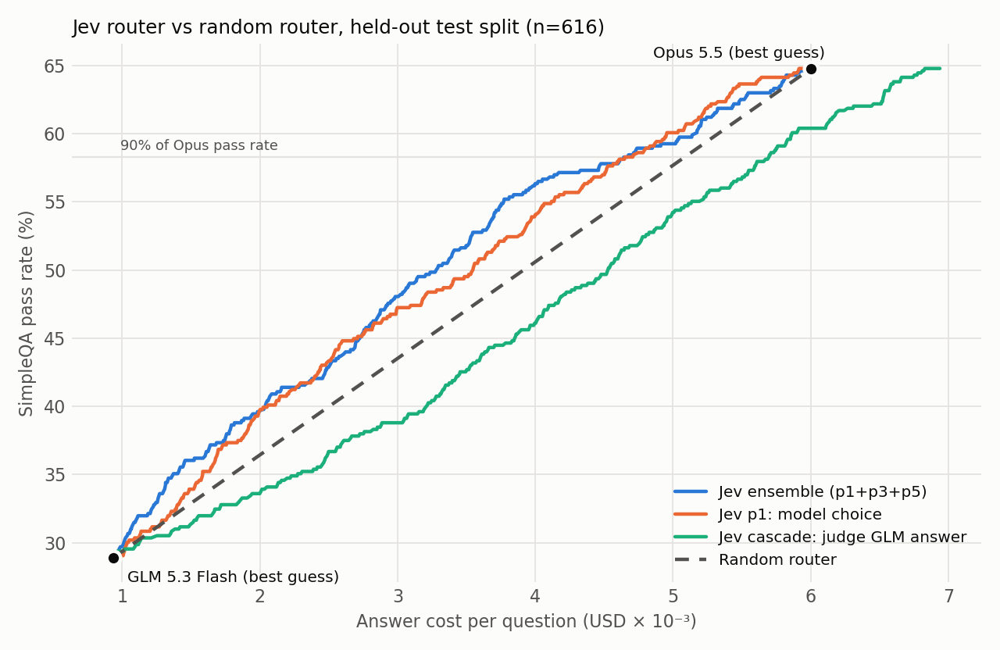

# Smart LLM Router: SimpleQA

A router that decides, per question, whether **Claude Opus 5.5** (strong, expensive) or **GLM 5.3 Flash** (weak, cheap) should answer a [SimpleQA](https://openai.com/index/introducing-simpleqa/) question. The decisions come from **TypeSafe Jev**, a decision model that returns calibrated probabilities instead of generated text.

Two goals were studied:
1. **Maximise pass rate**: the fraction of answers graded `CORRECT`.
2. **Cost/quality Pareto efficiency**: the best pass rate at each cost, compared with a **random router**.



## Setup

| Role | Model | Access | Price (input / output, per 1M tokens) |
|---|---|---|---|
| Expensive answerer | `anthropic/claude-opus-5-5` | Perplexity Agent API (`/v1/responses`) | $4 / $20 |
| Cheap answerer | `perplexity/glm-5.3-flash` | Perplexity Agent API | $0.15 / $0.50 |
| Decision model | `jev-latest` (= `jev-1.14.0`) | TypeSafe (`/v1/systemone`) | $0.042 / free |
| Grader | `openai/gpt-6.1-terra` with the official SimpleQA grader prompt | Perplexity Agent API | $1 / $5 |

- **Benchmark:** a seeded random subset of 1,000 of the 4,326 SimpleQA questions. It is answered closed-book: no web search tools are attached. A post-cutoff probe question confirmed that neither model searches the web.
- **Splits:** each question goes deterministically to tune (~40%) or test (~60%). All prompt choices, thresholds and fitted weights use the tune split, and every number below is reported on the **held-out test split**.
- **Answer prompt variants:**
  - Default: the bare question, as in the official eval.
  - `#guess`: the system instruction *"Answer the question with your single best guess. Never refuse..."*.
- **Cost:** the Perplexity-reported cost of the answer calls. Grader cost is excluded because it is evaluation-only. Jev costs about $0.00002 per call, which is negligible.

## Results

### 1. Base models (1,000 questions)

| Model | Correct | Incorrect | Not attempted | Correct given attempted | F1 | $/question | Mean latency |
|---|---|---|---|---|---|---|---|
| Opus 5.5 | 65.3% | 21.1% | 13.6% | 75.6% | 0.701 | $0.0099 | 6.7s |
| Opus 5.5 `#guess` | **66.4%** | 32.9% | 0.7% | 66.9% | 0.666 | **$0.0059** | 4.7s |
| GLM 5.3 Flash* | 26.2% | 41.4% | 32.4% | 38.7% | 0.312 | $0.0017 | 33.6s |
| GLM 5.3 Flash `#guess` | 28.6% | 61.3% | 10.1% | 31.8% | 0.301 | $0.0009 | 19.7s |

\* Only 814 of the 1,000 questions; see [Limitations](#limitations).

Telling a model to always commit to a best guess removes nearly all abstentions. It is also **40% cheaper for Opus**, because its answers and reasoning get shorter. Because pass rate only counts correct answers, guessing never lowers it.

### 2. Maximising pass rate

The decision model chooses between answers or answer modes, but never writes the final answer itself. Results are on the test split (n = 498, the questions with all four answer sets).

| Strategy | Pass rate | $/question | Description |
|---|---|---|---|
| random | 45.0% | $0.0056 | Coin flip between Opus and GLM |
| random (guess mode) | 47.2% | $0.0033 | Coin flip between Opus `#guess` and GLM `#guess` |
| always GLM | 27.7% | $0.0016 | |
| always Opus | 64.1% | $0.0099 | |
| always Opus `#guess` | 64.3% | $0.0060 | |
| Jev preroute | 64.1% | $0.0100 | Jev reads the question and picks a model; it nearly always picks Opus |
| Jev select (Opus, GLM) | 63.9% | $0.0116 | Both models answer and Jev picks one |
| Jev select (Opus, Opus `#guess`, GLM) | 65.1% | $0.0176 | |
| **Jev cascade → Opus `#guess`** | **67.3%** | $0.0118 | Opus answers. If Jev judges the answer an abstention (P(committed) < 0.8), Opus is re-asked in guess mode |
| *Oracle over Opus and GLM* | *66.1%* | | |
| *Oracle over all 4 answer sources* | *73.7%* | | |

Paired bootstrap on the test split, 95% CI:
- **Jev cascade vs always Opus: +3.2 pts [+1.8, +5.0].**
- Jev cascade vs always Opus `#guess`: +3.0 pts [+0.4, +5.8].

The cascade beats both single-model baselines, and even the Opus+GLM oracle. It keeps Opus's committed answers, which are more accurate (75.6% when attempted) than guess-mode answers (66.9%). It forces a guess only when Opus declines. GLM adds almost nothing to pass rate: it is the only correct model on just 2–4% of questions, and Jev can't reliably spot them.

### 3. Pareto efficiency: Jev router vs random router

To save cost, some questions must go to the cheap model. Each router scores how safe a question is to route cheap, and sweeping the threshold traces a curve from all-Opus to all-GLM. The **random router** sends a random fraction of questions to GLM, so its expected curve is the straight line between the two endpoints. The cheap model is GLM `#guess` and the expensive model is Opus `#guess`. The test split has n = 616.

- **Gain** is the mean pass-rate improvement over the random line, averaged across the whole cost range.
- **Cost cut @ X%** is the cost saved vs always Opus `#guess` while keeping at least X% of its pass rate.

| Router | Gain vs random (95% CI) | Cost cut @95% | @90% | @80% |
|---|---|---|---|---|
| **Random router** | 0 | 7.6% | 15.2% | 30.5% |
| **Jev ensemble p1+p3+p5** | **+3.1 pts [+1.8, +4.4]** | **11.3%** | **22.1%** | **41.4%** |
| Jev p5: hard answer kind + obscurity | +2.7 pts [+1.4, +4.1] | 12.6% | 20.4% | 41.4% |
| Jev p1: model choice | +2.4 pts [+0.7, +3.4] | 12.9% | 21.5% | 37.8% |
| Jev p3: obscurity rubric | +1.4 pts [+0.1, +2.7] | 7.1% | 18.5% | 36.6% |
| Jev p2: "is it well known?" | −1.7 pts | 7.3% | 14.4% | 26.6% |
| Jev cascade (GLM first, Jev judges its answer) | −3.5 pts | <0 | 5.0% | 20.8% |

At 80% of Opus quality, the best Jev router cuts cost by **41% vs 31% for random**. At 90% it cuts **22% vs 15%**. Above about 95% quality there is little to gain, because GLM is almost never the only correct model.

**The prompts tried for Jev, and how they did** (all in `pareto.py`):

| Version | Jev question(s) | Outcome |
|---|---|---|
| p1_choice | `choice`: which model, Opus or GLM, is more likely to be correct? | Works |
| p2_wellknown | `noul`: is this a widely known fact? | No better than random |
| p3_obscurity | `score`: five-level obscurity rubric | Works |
| p4_type | `choice`: answer type (date / number / person / place / other), then a logistic regression fitted on tune | Small gain; overfits the tune split |
| p5_hardkind | `noul` "exact date or a non-famous person?" plus the obscurity score, hand-weighted | Works; second best |
| p6_atomic | Six atomic `noul` features, then a logistic regression fitted on tune | Best on tune, 4th on test: overfits |
| p7_reference / p8_popdetail | "Reference-book fact?" / "pop-culture detail?", written from tune-split error analysis | **Worse than random on test**; rejected |
| **ens p1+p3+p5** | **Average of the ranks of p1, p3 and p5 (nothing fitted)** | **Best on test** |
| c1 / c2 (cascade) | Does GLM's answer commit to something? Is GLM's answer correct? | Worse than random: escalations pay for both models, and Jev can't verify GLM's facts |

**What we learned:**
- **Answer type is the strongest signal.** GLM gets 17% of exact-date questions right, against 87% for Opus. Its gap is much smaller on places and "other" answers.
- **Fitted combiners overfit** at a few hundred tune questions. Averaging ranks across unfitted prompts was the most robust approach.
- **Error-driven prompt tweaks overfit too.** p7 and p8 were written from the tune split's mistakes, and they fell apart on test.

## Limitations

- **Missing GLM answers.** The Perplexity API key started returning `401 Invalid API key` partway through the run, so 186 plain-GLM answers are missing (178 × 401, 2 × 402, 6 truncated). The Opus, Opus `#guess` and GLM `#guess` sets are complete for all 1,000 questions. Tables using plain GLM cover 814 questions (498 in test).
- **Mild test leakage.** The p1+p3+p5 ensemble was chosen after an early look at test results on 170 questions. Ranking strictly by tune would put it 3rd of 15, behind p6 and p5, both of which also beat random on test. Its lead held as the test set grew from 170 to 616 questions.
- **The model you asked for wasn't available.** DeepSeek v4.1 Flash is not offered by Perplexity. DeepSeek v4 Pro was used in a short pilot, then replaced by GLM 5.3 Flash at your request.
- **A subset, not the full benchmark.** Results come from 1,000 of the 4,326 SimpleQA questions, with a single LLM grader.

## Reproduce

```bash
# .env needs PERPLEXITY_API_KEY and TYPESAFE_API_KEY
python simpleqa.py --limit 50                 # answer + grade a sample with the default models
python router.py --limit 1000                 # answer sets + pass-rate strategies (Jev decider)
python router.py --limit 1000 --decider anthropic/claude-haiku-5-5   # LLM decider for comparison
python pareto.py && python plot_pareto.py     # Pareto analysis + chart
```

All model outputs and decisions are cached, so reruns only make the API calls that are missing.

| File | Purpose |
|---|---|
| `llm.py` | Async Perplexity Agent API client (retries; records cost, tokens, latency) |
| `jev.py` | Async TypeSafe Jev client |
| `simpleqa.py` | Dataset loading, answering, official SimpleQA grading, resumable per-model JSONL |
| `router.py` | Pass-rate strategies (preroute / cascade / select), thresholds tuned on tune split |
| `pareto.py` | Jev prompt versions, cost-vs-pass curves, bootstrap CIs, comparison with random |
| `plot_pareto.py` | Test-split Pareto chart |
| `results/<model>.jsonl` | Per-question answers, grades, cost, latency |
| `results/decisions/` | Cached decision-model outputs |
| `results/router_eval__*.csv`, `results/pareto_summary.csv`, `results/curves/` | Evaluation outputs |
